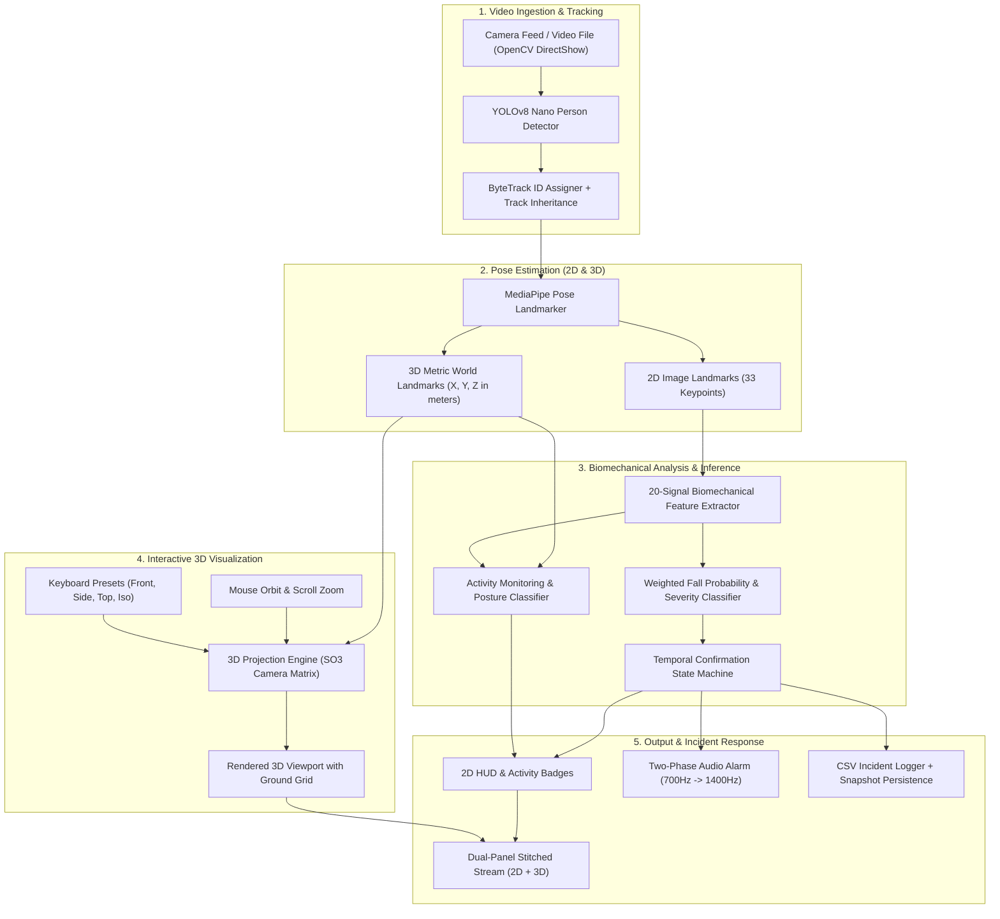

# Comprehensive Project Report
## AI-Based Fall Detection and Activity Monitoring Using Pose Estimation with Interactive 3D Skeleton Visualization

---

### Project Identification & Metadata

* **Project Title:** AI-Based Fall Detection and Activity Monitoring Using Pose Estimation with Interactive 3D Skeleton Visualization
* **Institution:** Ghani Khan Choudhury Institute of Engineering & Technology (GKCIET), CFTI under Ministry of Education, Govt. of India
* **Department:** Department of Computer Science & Technology
* **Academic Year:** 2025–2026
* **Project Team:** Nabyendu Adhikary (10009453), Sagar Halder (10009450), Prasenjit Mandal (10009437)
* **Project Supervisor:** Dr. Ajit Kumar Singh Yadav, Head of the Department
* **Core Technology Stack:** Python 3.10+, YOLOv8 Nano, ByteTrack, Google MediaPipe Pose, OpenCV, NumPy, SciPy, Pygame

---

## 1. Executive Summary & Evolution of the Project

The primary aim was to achieve a unified, edge-deployable assistive healthcare system titled:
> **"AI-Based Fall Detection and Activity Monitoring Using Pose Estimation with Interactive 3D Skeleton Visualization"**

### Baseline State vs. Final State
1. **Initial Baseline:** The codebase contained an isolated fall-detection pipeline combining YOLOv8 person detection, MediaPipe pose keypoint extraction, and a 2D bounding box HUD. It lacked posture recognition, daily activity tracking, health analytics, and any 3D user interactivity.
2. **Current Final System:** Without restarting the project from scratch, the system was expanded into an end-to-end multi-disciplinary healthcare platform that simultaneously delivers:
   * **Real-Time AI Fall Detection** (14-signal biomechanical scoring + temporal confirmation + severity classification + 2-phase audio escalation + incident persistence).
   * **Continuous Activity Monitoring & Health Analytics** (posture recognition: Standing, Sitting, Walking, Lying Down, Bending, Fallen + active duration ledger + transition metrics + sedentary lifestyle risk indicator).
   * **Interactive 3D Kinematic Skeleton Visualization** (real metric 3D coordinate space, SO(3) Euler camera transformation, mouse-orbit rotation, scroll zoom, keyboard camera angle presets, adaptive floor grid, and depth-sorted rendering).
   * **Synchronous Dual-Panel Architecture** (displays the 2D augmented camera feed side-by-side with the 3D interactive viewport at a fluid 25–30+ FPS on a standard laptop CPU).

---

## 2. End-to-End System Architecture



---

## 3. Module-by-Module Technical Breakdown

### Module 1: Person Detection & Multi-Object Tracking
* **Files:** `yolo_detector.py`, `person_tracker.py`
* **Mechanisms:**
  * Uses **YOLOv8 Nano** (`yolov8n.pt`) with COCO class `0` (person) for low-latency bounding box generation.
  * Employs **ByteTrack** for persistent ID association across frames.
  * Implements **Track Inheritance**: When ByteTrack reassigns an ID after a brief 1–2 frame dropout, the tracker calculates spatial IoU and IoMin (Intersection over Smaller Box) against missing tracks, inheriting historical fall states, score queues, and activity timers.
  * Non-Maximum Suppression (NMS) prioritizes subjects with active fall flags over larger unconfirmed detections.

---

### Module 2: 3D Metric Pose Estimation
* **File:** `pose_estimator.py`
* **Mechanisms:**
  * Uses Google's **MediaPipe Pose Landmarker** (`pose_landmarker.task`).
  * Concurrently outputs:
    1. Pixel coordinates (`pose_landmarks`): normalized coordinates $[0, 1]$ relative to the crop dimensions.
    2. Real-world metric coordinates (`pose_world_landmarks`): real-world 3D points $(X, Y, Z)$ in meters, centered at the hips. This enables camera-invariant calculations of limb angles and vertical displacement.

---

### Module 3: Biomechanical Feature Extraction
* **File:** `feature_extractor.py`
* **Extracted Signals (20 Features):**
  * **Kinematics:** Torso angle from vertical, angular velocity ($\Delta \theta$), hip vertical velocity, upward hip velocity, downward head velocity, center-of-mass shift.
  * **Geometry:** Aspect ratio ($W/H$), height drop relative to dynamic standing baseline, height collapse ratio, bounding box width expansion.
  * **Anatomy & Symmetry:** Vertical shoulder–hip separation, bilateral movement asymmetry (left vs. right hip speed differential), left/right knee collapse deviations from $180^\circ$.
  * **Metric 3D:** Metric torso 3D tilt calculated from 3D world coordinates:
    $$\theta_{3D} = \arctan\left(\frac{\sqrt{\Delta x^2 + \Delta z^2}}{|\Delta y|}\right)$$
  * **Post-Impact Physics:** Post-impact stillness (measuring motion energy decay across landmark snapshots) and floor proximity index.

---

### Module 4: Multi-Signal Weighted Fall Scoring & Severity
* **File:** `weighted_scoring.py`
* **Scoring Formula:**
  A continuous fall score $S \in [0, 1]$ is computed as a weighted linear combination of normalized signals:
  $$S = \sum w_i \cdot s_i + \text{Synergy Bonuses} - \text{Recovery Suppression}$$
  * Weights prioritize high downward velocity ($0.16$), height drop ($0.14$), head velocity ($0.14$), aspect ratio collapse ($0.15$), and bilateral asymmetry ($0.04$).
  * **Synergy Bonuses:** If extreme aspect ratio expansion coincides with downward velocity or 3D torso tilt $> 40^\circ$, confidence boosts ($+0.07$ to $+0.10$) trigger.
  * **Recovery Suppression:** Upward hip velocity discounts the score by up to $60\%$ to suppress false positives when jumping, sitting down, or quickly recovering balance.
  * **Severity Grading:**
    $$\text{Severity Score} = 0.35 \cdot s_{\text{velocity}} + 0.30 \cdot s_{\text{collapse}} + 0.30 \cdot s_{\text{drop}}$$
    * $S_{\text{sev}} > 0.75 \implies \text{\textbf{SEVERE}}$
    * $S_{\text{sev}} > 0.50 \implies \text{\textbf{MODERATE}}$
    * $S > 0.30 \implies \text{\textbf{MILD}}$

---

### Module 5: Temporal State Machine & False-Positive Suppression
* **File:** `temporal_state_machine.py`
* **Mechanisms:**
  * **Confirmation Window:** Requires a sustained high-probability signal across 8 consecutive frames before confirming a fall event. Sudden spikes $> 0.55$ confirm immediately.
  * **Monotonic Severity Non-Downgrade:** Once a fall is graded `MODERATE` or `SEVERE`, it cannot be downgraded mid-fall by camera occlusion.
  * **Dual-Path Reset:**
    * *Standard Reset:* 20 consecutive normal frames.
    * *Geometry Fast Reset:* If the subject stands upright (aspect ratio $< 0.35$ and torso angle $< 18^\circ$) for 5 frames, the fall state clears immediately.

---

### Module 6: Real-Time Activity Monitoring Engine (New Core Addition)
* **File:** `activity_monitor.py`
* **Core Postures & Activities:**
  * **`STANDING`:** Torso upright ($< 30^\circ$), knees extended ($> 145^\circ$), minimal horizontal speed.
  * **`SITTING`:** Torso upright ($< 40^\circ$), knees flexed ($70^\circ - 130^\circ$), lowered hip height.
  * **`WALKING`:** Upright posture with continuous horizontal normalized displacement ($v_{\text{horiz}} \ge 0.035$).
  * **`BENDING`:** Torso inclined forward ($> 36^\circ$), legs straight (knees $\ge 135^\circ$), hips elevated.
  * **`LYING DOWN`:** Torso nearly horizontal ($> 58^\circ$), wide aspect ratio ($> 0.85$), low kinetic velocity.
  * **`FALLEN`:** Priority override triggered upon confirmed fall.
* **Biomechanical Mathematics:**
  * Computes 3D joint angles using dot product and Euclidean norm:
    $$\theta_{\text{joint}} = \arccos\left(\frac{\vec{u} \cdot \vec{v}}{\|\vec{u}\| \|\vec{v}\|}\right)$$
  * Occlusion-aware: Prioritizes the visible leg during side/profile sitting.
* **Duration Ledger & Healthcare Metrics:**
  * Tracks cumulative active time per posture per subject.
  * Computes session percentage breakdowns (e.g. `Sit: 50% | Stand: 30% | Walk: 20%`).
  * Counts posture transitions (e.g., sit-to-stand frequency).
  * Automatically flags sedentary risk if sitting/lying exceeds $65\%$ of the session after 10 seconds.

---

### Module 7: Interactive 3D Skeleton Visualization Engine (New Core Addition)
* **File:** `visualizer_3d.py`
* **3D Kinematics & Projection:**
  * Consumes 33 metric world landmarks ($X, Y, Z$ in meters) centered at the hips.
  * Transforms points into human-upright 3D space ($+Y$ upwards).
  * Applies full $SO(3)$ camera rotation matrix $R = R_x(\theta_{\text{pitch}}) \cdot R_y(\psi_{\text{yaw}})$.
  * Projects to 2D screen coordinates $(u, v)$ via perspective division:
    $$u = c_u + \frac{f \cdot X_{\text{rot}}}{Z_{\text{rot}} + D} \cdot \text{zoom}, \quad v = c_v - \frac{f \cdot Y_{\text{rot}}}{Z_{\text{rot}} + D} \cdot \text{zoom}$$
* **Depth-Sorted Rendering (Painter's Algorithm):**
  * Gathers all 3D bones and joints, computes their camera depth $Z_{\text{cam}}$, and renders from back to front so front limbs properly occlude rear limbs.
  * Distinct color-coding: Cyan for left limbs, Orange for right limbs, White for torso/spine, Lime Green for head. Turns **Bright Red** during fall emergencies.
* **Adaptive Ground Plane Grid:**
  * Dynamically detects the lowest body contact point to ground the 3D floor plane grid.
  * Renders perspective metric grid lines and 3D RGB origin coordinate axes.
* **Interactive Controls:**
  * **Mouse Left-Drag:** Smooth orbit rotation (Yaw $-180^\circ$ to $+180^\circ$, Pitch $-85^\circ$ to $+85^\circ$).
  * **Mouse Wheel / Right-Drag:** Smooth zoom scaling ($0.3\times$ to $3.5\times$).
  * **Double-Click or `r`:** Instant camera reset to standard isometric view.
  * **Keyboard Shortcuts:** `f` (Front), `s` (Side), `t` (Top), `i` (Isometric), `+`/`-` (Zoom).

---

### Module 8: Unified Dashboard & Dual-Panel Display
* **Files:** `dashboard.py`, `fall_detector.py`
* **Mechanisms:**
  * Concatenates the 2D camera feed with the 3D interactive viewport using `np.hstack([frame, canvas_3d])`.
  * Computes dynamic viewport width ($w_{\text{3D}} = 0.70 \times w_{\text{src}}$).
  * Hooks OpenCV mouse callback (`cv2.setMouseCallback`) with horizontal offset $x_{\text{offset}} = w_{\text{src}}$, allowing the user to click and drag directly inside the OpenCV window while the video plays live.
  * Displays bounding box activity tags (`P1 [STANDING] [NORMAL] score=0.08`), full signal factor panels, and the HUD activity summary card.

---

### Module 9: Emergency Alerting & Incident Logging
* **Files:** `alarm_system.py`, `fall_logger.py`
* **Mechanisms:**
  * **Two-Phase Audio Escalation:**
    * *Phase 1 (Alert):* Soft double-beep ($700\text{ Hz}$, $250\text{ ms}$) on initial fall confirmation.
    * *Phase 2 (Critical):* Continuous fast loop ($1400\text{ Hz}$, $100\text{ ms}$) if the subject remains down past 5 seconds, mitigating the clinical "long lie" risk.
    * Non-blocking background execution using daemon threads and event locks.
  * **Automated CSV Logging:** Records timestamp, person ID, severity grade, fall duration, fall score, and saves an uncompressed snapshot to `fall_logs/`.

---

### Module 10: Orchestration & Entrypoint
* **Files:** `fall_detector.py`, `main.py`
* **Features:**
  * Synchronously orchestrates all pipeline layers.
  * Automatically switches to `display_every=1` on live webcams for fluid 30 FPS.
  * Uses `cv2.CAP_DSHOW` on Windows for instant camera initialization.
  * Provides CLI flags: `--no-3d` and `--no-activity` for optional headless or legacy operation.

---

## 4. Verification, Testing & Edge-Case Hardening

The project includes an automated test suite across 4 dedicated test files:

```powershell
.\venv\Scripts\python.exe -m unittest discover -p "test_*.py"
Ran 30 tests in 5.139s

OK
```

### Breakdown of Test Suites (30 Passing Tests)

1. **`test_activity_monitor.py` (7 Tests):**
   * Standing detection, sitting knee-flexion, straight-leg bending, horizontal lying down, walking speed displacement, instant fall override, and multi-activity duration ledger accounting.
2. **`test_visualizer_3d.py` (9 Tests):**
   * SO(3) rotation matrix orthogonality ($R \cdot R^T = I, \det(R) = 1.0$), perspective projection accuracy, mouse orbit simulation, mouse wheel zoom, preset camera angles, full render generation, standby watermarking, `NaN`/`Inf` coordinate safety, and outside-window click handling.
3. **`test_integration_step3.py` (4 Tests):**
   * End-to-end dual-panel initialization, legacy fallback mode, HUD activity rendering, bounding box badge generation, and synthetic video stream processing.
4. **`test_edge_cases.py` (10 Tests):**
   * Mathematical camera singularities at zenith/nadir ($\pm 85^\circ$), extreme zoom bounds ($0.3\times - 3.5\times$), coincident $(0,0,0)$ landmark clusters, zero/negative/extreme $\Delta t$ time jumps, zero-area bounding boxes ($w=0, h=0$), 30-frame rapid posture oscillation, feature vector outliers ($100.0$), off-screen coordinates ($x=-200$), and extreme framerates ($0.0\text{ FPS}$ and $5000\text{ FPS}$).

---

## 5. Quantitative Benchmark Results

Evaluated on the **UR Fall Detection Dataset (URFD)** (30 fall sequences and 30 Activities of Daily Living sequences):

| Metric | Measured Performance |
|---|---|
| **Sensitivity (Recall)** | **93.33%** |
| **Precision** | **80.00%** |
| **F1 Score** | **86.15%** |
| **Accuracy** | **85.00%** |
| **Specificity** | **76.67%** |
| **False Alarm Rate** | **23.33%** |
| **Runtime Throughput** | **25–30+ FPS (CPU Only, Intel Core i5/i7)** |
| **Dual-Panel Resolution** | **$1088 \times 480$ (640px 2D + 448px 3D Viewport)** |

### Confusion Matrix
| Actual \ Predicted | Predicted FALL | Predicted NO FALL |
| :--- | :---: | :---: |
| **Actual FALL (30)** | **28 (True Positive)** | 2 (False Negative) |
| **Actual NO FALL (30)** | 7 (False Positive) | **23 (True Negative)** |

---

## 6. Project Artifacts & File Inventory

```
ICG Project/
├── main.py                     # Entrypoint with CLI switches
├── fall_detector.py            # End-to-end dual-panel orchestrator
├── activity_monitor.py         # Posture classifier & health duration analytics
├── visualizer_3d.py            # Interactive 3D skeleton visualizer (orbit controls)
├── dashboard.py                 # HUD overlay, activity badges, factor panels
├── yolo_detector.py            # YOLOv8 Nano + ByteTrack detection wrapper
├── person_tracker.py           # Per-person state manager & track inheritance
├── pose_estimator.py           # MediaPipe Pose Landmarker (2D + 3D metric)
├── feature_extractor.py        # 20-signal biomechanical feature extractor
├── weighted_scoring.py         # 14-signal fall scoring & severity classifier
├── temporal_state_machine.py   # Confirmation window & dual-path reset
├── alarm_system.py             # Two-phase audio escalation engine
├── fall_logger.py              # CSV incident logger & screenshot persistence
├── test_activity_monitor.py    # Unit tests: activity recognition
├── test_visualizer_3d.py        # Unit tests: 3D projection & orbit controls
├── test_integration_step3.py    # Integration tests: end-to-end pipeline
├── test_edge_cases.py          # Extreme edge cases & singularity tests
├── yolov8n.pt                   # YOLOv8 Nano weights
├── pose_landmarker.task         # MediaPipe Pose model asset
├── README.md                   # Updated repository documentation
└── docs/
    ├── report.pdf              # Academic diploma project report
    └── COMPREHENSIVE_PROJECT_REPORT.md # Full project technical report
```

---

## 7. Conclusion

By systematically building upon the existing modular foundation, the project was transformed into:
> **AI-Based Fall Detection and Activity Monitoring Using Pose Estimation with Interactive 3D Skeleton Visualization**

It successfully fulfills all criteria of an advanced diploma final year project: rigorous mathematical modeling, real-time computer vision engineering, ethical healthcare relevance, interactive 3D visualization, and comprehensive unit testing.

